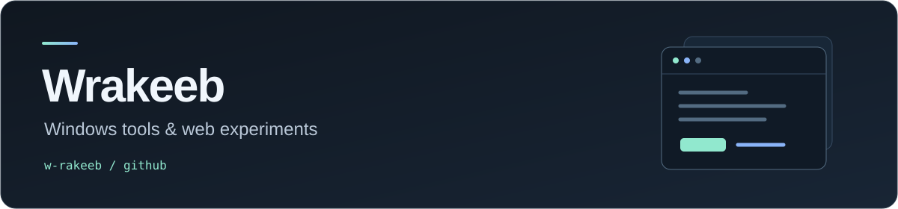

  

I make small apps that make everyday things easier — desktop controls, portable utilities, and web experiments.

[Website](https://wrakeeb.my.id) · [Browse my repositories](https://github.com/w-rakeeb?tab=repositories)

### Selected projects

| Project | What it does |
| :--- | :--- |
| [**PulseMute**](https://github.com/w-rakeeb/PulseMute) | Microphone control with keyboard, mouse, and controller shortcuts. |
| [**Brightness Control**](https://github.com/w-rakeeb/brightness-control) | Portable brightness controls for multiple monitors using DDC/CI. |
| [**StickyN**](https://github.com/w-rakeeb/StickyN) | Portable Windows sticky notes with paper designs and local storage. |
| [**Vencord Auto Repair**](https://github.com/w-rakeeb/vencord-auto-repair) | A PowerShell watcher that repairs missing Vencord patches using the official installer. |

### Forks I work on

- [**Codex Presence**](https://github.com/w-rakeeb/Codex-Presence) — a Windows desktop companion for Discord Rich Presence, with privacy controls.
- [**Coucou Windows**](https://github.com/w-rakeeb/coucou-windows) — a Windows fork for monitoring coding sessions, usage, and allowance timers.

### Project stack

